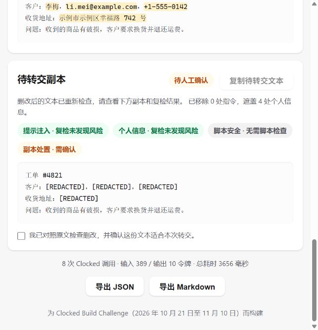

# Preflight

**Check unfamiliar content before Codex reads it.**

Agents now read email, web pages, documents and code written by strangers. Preflight is the
30-second check you run *before* that content reaches your agent: paste it (or drop a PDF /
image, or give it a URL), get an **allow / review / block** verdict with character-exact
evidence, local disposition rules, and a prepared text copy. Edits are checked again
before the copy is offered; removing an instruction always requires human review.

Built for the **Clocked Build Challenge** (Oct 21 – Nov 10, 2026).

Interface changes follow the repository [UI spec](docs/UI_SPEC.md) and [contributor instructions](AGENTS.md).

## Codex input handoff

The primary workflow is a Codex task that needs to read an unfamiliar file or website.
The local MCP tool `preflight_open` accepts its path or URL and screens it before body
text is returned to Codex. Ready copies can be read immediately; review-required copies
return a local review link. A person examines the existing report and edit comparison,
then approves the exact copy hash or rejects it. `preflight_read` retrieves the approved
snapshot. It cannot approve a ticket and blocked results never include source text.

The server starts its own loopback review page, so no separately launched web service is
needed. Tickets remain in memory for at most 30 minutes and disappear on disconnect.
Codex receives only the status and usable content or a review link; detailed reports
remain on the review page. The existing web interface and exports remain available. This workflow is cooperative;
it does not intercept arbitrary Codex shell/browser reads. See
[Codex integration](docs/CODEX_INTEGRATION.md) for project configuration, source limits,
data flow and the release contract. No demonstration site or video is included.

## The problem

Prompt injection is the #1 risk in the OWASP Top 10 for LLM applications, and real zero-click
agent leaks have already shipped in the wild. Meanwhile the standard workflow is still
"copy suspicious content, paste it into your agent, hope for the best". Preflight makes the
paranoid step automatic — for **any** kind of agent input, not one vertical.

## Features

- **Single scan** — paste text, get the full three-layer report with annotated source.
- **PDF & image scans** — drop a contract PDF or a screenshot; multimodal endpoints do the rest.
- **PDF text-layer signals** — local checks expose invisible/transparent text, very small
  fonts, off-page text, suspicious Unicode and possible instructions in metadata. Each
  finding includes its page, source text and coordinates where available. No pages are
  rendered; no OCR, background comparison or occlusion detection is performed. Light
  text alone is informational because its background is not inspected.
- **URL scan** — give it a link: deterministic domain checks (lookalike/homoglyph brands,
  suspicious TLDs, punycode, raw IPs) plus a semantic page summary (forms, links, headings,
  inline scripts) judged by Clocked. The page is fetched **statically — its JavaScript is
  never executed**, so analyzing hostile pages is safe.
- **Batch triage** — paste up to 10 items separated by `---`; results are ranked by risk and
  each row opens the full report. One Clocked `compare` call groups items that are the same
  content reworded (one campaign sent several times) and flags items that contradict each other.
- **Prepared copy** — remove validated injection evidence and fully mask personal-data
  spans, then run the edited text through the complete scan again. Unchanged clean text
  reuses its scan. Risky script inputs are replaced in full with a fixed marker without
  extra model calls. Residual risks, invalid offsets and recheck failures withhold other
  edited copies; instruction/script removal or a review verdict requires confirmation.
- **Review each edit** — open the prepared copy's comparison dialog to compare the exact
  original span with its replacement and see why it changed. The edit log preserves
  Unicode source/copy positions and is included in JSON and Markdown exports.
- **One-click examples** — three primary examples (ordinary notes, a project update with
  a hidden instruction, a private support ticket), plus malicious and benign scripts,
  batch triage and a live official-site URL control. Text examples are synthetic and
  available in English and Chinese; the URL example reads the current public page.
- **Export** — every report downloads as JSON or a Markdown audit artifact.
- **Live progress, two languages** — scans stream each step as it starts; the UI switches
  between English and Chinese.

## How a scan works

The original scan takes four or five Clocked calls. An edited copy adds another four
or five calls for a complete recheck (at most ten total); unchanged text adds none.

| # | Layer | Clocked endpoint | How the output changes the app |
|---|-------|------------------|--------------------------------|
| 1 | Guard | `injection` | Injection score, category breakdown and severity drive the Guard card; every evidence span (`start`/`end`) is highlighted in red in the annotated source. |
| 2 | Protect | `pii` | Entity list populates the Personal data card; validated source spans are fully masked when preparing a copy. The API's PII-only `anonymized_text` is retained in JSON, but is never offered as a checked copy. |
| 3 | Routing | `decide` | Decides whether the content contains executable code. If not, layer 4 is skipped entirely — no unnecessary API calls. |
| 4 | Inspect | `script` | Malicious/suspicious scores and threat category drive the Script card; evidence spans are highlighted in purple. Runs **only** when routing says there is code. |
| 5 | Verdict | `decide` | Reads a structured summary of layers 1–4 and recommends `allow / review / block`; local policy can raise the disposition. Original model choice, probabilities and confidence remain visible. |

PDF/image scans run layers 1–3 and 5 (4 calls); `script` is a text-only endpoint, so file
scans say so explicitly instead of pretending.

### Disposition and prepared copies

`app/policy.py` supplies versioned floors: high/critical injection or malicious scripts
require **block**; other flagged results, personal contact/identity data, uncertain
routing and incomplete checks require at least **review**. Confident credential
harvesting also blocks a URL. The policy never reduces a model block. An allow below
0.5 model confidence becomes review; that cutoff is a review policy, not a measured
accuracy guarantee. The gauge and probability bars describe the model recommendation,
not a manufactured confidence in the policy outcome.

For text, `app/handoff.py` validates every edit against the original Unicode code-point
offsets, merges overlapping spans and constructs the copy in one pass. Injection
instructions are removed; detected personal-data values are replaced in full with
`[REDACTED]`. Names alone do not trigger masking or another scan; when contact/identity
data is present, names are masked too. An input classified as a risky script is replaced
in full with the fixed `[Script removed]` marker, with the entire change shown in the
edit comparison. No original code is retained or repaired, and copying requires confirmation.
This fixed replacement is validated locally without extra model calls. Other edited text
is scanned again with Guard, Protect, routing, conditional Inspect and Decide. A copy
with remaining risks or personal data is withheld from handoff copying; its edited draft
remains visible for inspection and manual revision. A copy whose injection was removed
always needs human review, even when its recheck passes. The original block stays block.
Files and URLs receive reports only; no text copy is implied for those modes.



### URL scans (link preflight)

The page is fetched without executing its JS and parsed into a semantic summary (title,
description, headings, JSON-LD structured data, forms + field types, link text→href pairs,
download buttons, inline script sources). No brand list is needed to judge it:

- **Who does the page claim to be?** Clocked `extract` pulls the claimed organization and
  product from the title, description and structured data, in any language.
- **Where does that identity really live?** The claimed name is looked up on Wikidata
  ("official website", falling back to the developer / owner when a product lists none).
- **How trustworthy is the domain?** Registration date via RDAP (WHOIS port 43 for TLDs
  without RDAP, such as `.cn`), and popularity via the Tranco top-1M list (cached locally).
- Small deterministic checks stay: punycode, raw-IP hosts, missing HTTPS, download targets
  hidden in script variables.

Then up to seven calls covering **all three Clocked capability groups** (Guard, Inspect and
Grounding are independent and run in parallel):

| # | Layer | Endpoint | What it decides |
|---|-------|----------|-----------------|
| 0 | Claimed identity | `extract` | Organization / product the page presents itself as, with character offsets. |
| 1a | Suspicious passages | `rerank` (conditional) | The page text is split mechanically into ~300-character passages; one rerank call scores all of them against "asks for credentials, pushes a download, or creates urgency" and the top passages (not marked `skip`) are handed to the next Decide and shown in a "Most suspicious passages" card. Runs only when the text is longer than the 1,500 characters Decide reads, so a phishing form buried at the bottom of a long page is no longer cut off. |
| 1 | Impersonation + intent | `decide` (dual question) | Impersonation vs legitimate; credential harvesting vs scam vs benign. |
| 2 | Guard | `injection` | Prompt injection aimed at agents reading the page. |
| 3 | Inspect | `script` (conditional) | Static analysis of inline scripts (never executed). |
| 4 | Identity | `grounding` (conditional) | Checks "this site is an official property of X" against the public record (Wikidata domains, registration date, rank); runs only when the page claims an identity. |
| 5 | Verdict | `decide` | allow / review / block. An `allow` below 0.5 confidence is shown as **review**, with the model's own choice kept in the report. |

Lookups fail soft: an unreachable registry or Wikidata yields "unknown", never a risk signal.
**Data flow note:** URL scans send the scanned domain to IANA/RDAP or WHOIS registries,
Wikidata and (once) Tranco, in addition to Clocked.

The **Sources and evidence** card shows a short summary; its centered detail dialog
separates extracted page claims from public records without expanding the page.
Exact claims include their source context; unmatched offsets are explicitly unverified.
Registry records link to the actual RDAP response when available (WHOIS lists its server),
identity records link to the Wikidata entity supplying the domains, and Tranco results
identify the list source and local cache date. Missing records remain unknown. A retrieval
receipt records the requested and final analyzed URL, redirect chain, fetch time and
SHA-256 of the response body. These fields reuse existing lookups and add no model calls.

Field test (Oct 26, 2026, real APIs): five fake Chinese download mirrors (UU远程 ×2, 腾讯会议,
钉钉, 夸克网盘) were all blocked at 0.95–0.99, and the official `y.qq.com` download page was
allowed at 0.99 — with no Chinese brand in any table.

SSRF-safe by construction: private/loopback/link-local targets are refused unless
`PREFLIGHT_ALLOW_PRIVATE_URLS=1` (used only to scan the bundled synthetic demo page at
`/static/demo/phish.html`, whose exfil target is the reserved `.invalid` TLD).

Awards entered: **Best Use of Protect/Guard/Inspect** (all three endpoints, full breadth) and
**Best Overall App** — on top of the three safety endpoints, URL scans add `extract`, a
dual-question `decide`, `rerank` and identity `grounding`, and batch triage adds `compare`:
eight endpoints in the scan workflows, each one changing what the app decides or shows.
An optional **Generate review report** button beside the JSON and Markdown exports uses
the ninth endpoint, `fill`, to write a title, risk summary and human-review suggestions.
It does not rerun detection or change the original disposition, evidence or copy approval.
The draft opens in the shared detail dialog and is cached per scan and language. Reopening
it makes no additional call. Generation usage is reported separately from scan usage;
generation failure leaves both exports available. Only curated scan facts are sent to Fill,
not the full original text or prepared copy. If no review suggestion is returned, a fixed
manual-comparison reminder is used and identified as a template in the generated record.

The page initially uses English and remembers language changes. Markdown headings and
descriptions use the language selected at export time, while source quotations stay verbatim.
JSON keeps stable technical keys and raw scan values, adds the selected `language`, and
includes the generated `review_report` for that language when available. Markdown includes
the same generated draft without replacing the fixed scan facts.
**Best Use of Verify/Compare/Rerank** is also within reach: all three endpoints of that group
are used (`grounding` and `rerank` in URL scans, `compare` in batch triage).

## Uncertain results, missing information, failed requests

- **Uncertain:** an `allow` below 0.5 confidence is shown as **review**; the model's own
  choice and probabilities stay in the report. Local policy floors also apply.
- **Missing information:** a page with no readable HTML text skips Guard with an explicit
  note and a review floor; no inline scripts means no Inspect call; a short page skips rerank and is read in
  full; an unreachable registry, Wikidata or Tranco yields "unknown", never a risk signal.
- **PDF limits:** text-layer inspection checks at most 20 pages / 5,000 text spans and
  returns at most 40 findings. Encrypted, unparseable, image-only or limit-truncated
  results remain incomplete and require review. Structural hidden-text signals also
  require review; they do not by themselves prove an attack.
- **Optional layers fail soft:** if the batch `compare` call fails, every item keeps its own
  verdict and the grouping is simply omitted.
- **Failed requests:** Clocked errors map to honest HTTP responses (401 bad key, 402 out of
  credits, 429 rate limit, 504 timeout); a page that cannot be fetched is reported as such
  instead of being scanned. No scan ever silently falls back to a fake result.
- **Copy recheck fails:** the original report remains available, but the candidate text
  is withheld. Successful calls before the recheck failure are included in usage totals.

## Run it locally

```bash
uv sync                              # install clocked-sdk + fastapi + uvicorn
cp .env.example .env                 # then put your key in .env
uv run uvicorn app.main:app          # http://127.0.0.1:8000
```

No build step, no database. Text and file scans talk only to the Clocked API; URL scans also
query RDAP/WHOIS, Wikidata and Tranco (see the data flow note above).
The API key lives only in `.env` (git-ignored) and is never exposed to the browser.

## Tests

```bash
uv run pytest -q                       # unit tests + strict recorded-response replay, no Clocked calls
node --test tests/test_ui.cjs          # Unicode highlighting, copy gating, exports and language coverage
uv run python -m scripts.record_cases  # replay the real-response corpus offline
```

CI (`.github/workflows/ci.yml`) runs the Python and UI suites plus both JS syntax checks.
Pytest disables the SDK's live transport to prevent accidental credit use.
Tests lock the pipeline contract: call ordering, the conditional Inspect skip, the progress
stream, masking
parameters, verdict-summary forwarding, usage aggregation, the API error mapping,
deterministic URL checks, and SSRF refusal.

Seven versioned synthetic text cases have real Clocked requests/responses and billing
metadata in `tests/fixtures/recordings/`. All seven original dispositions matched the
predeclared expectations. Six of seven full outcomes matched: the private-ticket copy
remained review instead of ready, despite no remaining PII. We preserve that conservative
result, rather than changing the expectation to claim a perfect score. This tiny corpus
is a regression/demo set, not an estimate of real-world detection accuracy. See
[`tests/fixtures/recordings/README.md`](tests/fixtures/recordings/README.md) for results,
the initial false positive and recording instructions.

## Measured costs (real runs, Oct 2026)

| Scenario | Calls | Tokens | Wall time |
|---|---|---|---|
| Text scan with code (5 layers) | 5 | 259 in / 5 out | ~2.4 s |
| PDF scan, 1 page (4 layers) | 4 | 93 in / 5 out | ~2.2 s |
| URL scan, synthetic phishing page (5 layers) | 5 | 424 in / 10 out | ~3.0 s |
| URL scan, real site with reputation lookups (6 layers, measured before parallelizing) | 6 | ~1,500 in / 10 out | 3–7 s (first scan +10 s to load Tranco) |
| Batch of 2 (before `compare` was added) | 8–9 | ~500 in | ~4 s |

A full development cycle fits comfortably inside the 20,000 challenge credits.

## Limitations (honest section)

- Preflight is a pre-screening aid, not a guarantee: treat every verdict as one signal.
- Deterministic forgeries (fake invoices with correct checksums, lookalike domains) are out of
  scope; Preflight judges content semantics, not business-logic truth.
- Script inspection requires pasted code text; PDFs with embedded scripts get the verdict
  from the other layers and an explicit note instead of a pretend result.
- URL reputation is evidence, not proof: a new, unranked domain can be a legitimate new
  site, and Wikidata does not know every product (e.g. 夸克网盘); then the verdict rests on the
  other layers. A fake download source is flagged, but the installer itself is never fetched
  or analyzed.
- Batch is capped at 10 items and 20,000 characters each; this is a preflight gate, not a
  streaming pipeline.

## Stack

- Python 3.10+, managed with [uv](https://docs.astral.sh/uv/)
- `clocked-sdk` 0.7.0 (sync client, retries and idempotency built in)
- PyMuPDF 1.x for native PDF text attributes; no OCR or layout-model dependencies
- FastAPI + one static HTML/CSS/JS page — no frontend build chain
